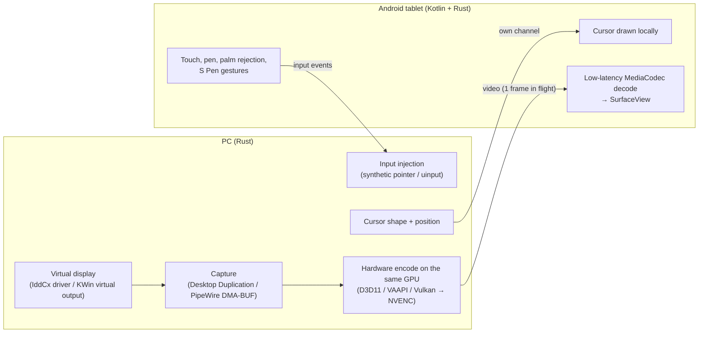

<div align="center">


# ezdisplay

**Turn your Android tablet into a real extended monitor and pen display for your PC, over a USB cable, with very low latency.**

[](https://github.com/LibreStatic/ezdisplay/actions/workflows/ci.yml)
[](https://github.com/LibreStatic/ezdisplay/actions/workflows/android.yml)
[](https://github.com/LibreStatic/ezdisplay/actions/workflows/linux-packages.yml)
[](https://github.com/LibreStatic/ezdisplay/releases)
[](#license)

Windows · KDE Plasma 6, GNOME, Sway and Hyprland (Wayland) · X11 · Android tablets · Rust + Kotlin

[Download](https://github.com/LibreStatic/ezdisplay/releases) ·
[Install](#install) ·
[How it works](#how-it-works) ·
[Architecture](docs/architecture.md) ·
[Protocol](docs/protocol.md)

</div>

---

ezdisplay creates a **real virtual monitor** on your PC (not a mirror), streams it to the tablet at
the tablet's **native resolution and refresh rate (up to 120 Hz)**, and sends touch and pen input
back as real touch-screen and stylus devices. It is free, open source, has no account, no cloud
and no telemetry, and everything travels through the cable.

## Why ezdisplay?

- **A real second monitor.** The tablet shows up in your display settings like any other screen;
  drag windows onto it and arrange it next to your other monitors.
- **The cursor never lags.** The pointer travels on its own channel and is drawn on the tablet
  itself, so moving the mouse never waits for a video frame.
- **Zero-copy, same-GPU pipeline.** The virtual display is rendered, captured and encoded on one
  GPU with no CPU or cross-GPU copies. On hybrid laptops ezdisplay picks the GPU that avoids
  shuttling frames across PCIe, and tells you when the system disagrees.
- **Frames are never queued.** The link carries at most one video frame in flight; when it is busy,
  the host waits and encodes the newest picture instead of piling up stale ones.
- **A pen display, too.** Pressure, tilt and hover reach drawing apps such as Krita as a real
  stylus, with palm rejection and configurable S Pen button gestures.
- **Measured, not guessed.** About **26 ms median from host capture to decoded frame** at
  2960×1848 / 120 Hz over USB 2.0 on the development tablet
  ([method and numbers](docs/phase0-findings.md)). The design target is ~30 ms glass to glass.
- **Plug in and it works.** The tray app finds the tablet over ADB, opens the app on it and starts
  streaming. The Windows installer sets up the virtual display driver for you.
- **Speaks your language.** Both apps are fully localized into English, Spanish, French,
  Portuguese, Italian and German.

## Status

ezdisplay is in **alpha** (see the [releases](https://github.com/LibreStatic/ezdisplay/releases); every change merged to `main` is published as a pre-release).
Working today, over USB with ADB:

| | Windows | KDE Plasma 6 (Wayland) | GNOME (Wayland) | Sway, Hyprland | X11 |
| --- | :---: | :---: | :---: | :---: | :---: |
| Extended display at native resolution and refresh rate | ✅ | ✅ | 🧪 | 🧪 | 🧪 |
| Locally drawn cursor | ✅ | ✅ | 🧪 | 🧪 | 🧪 |
| Zero-copy hardware encode | ✅ | ✅ | 🧪 | ❌ shared-memory capture | ❌ shared-memory capture |
| Touch, pen pressure, tilt and hover | ✅ | ✅ | 🧪 | 🧪 | 🧪 |
| Tray app with settings and live statistics | ✅ | ✅ | 🧪 | 🧪 | 🧪 |
| Installer / packages | ✅ `.exe` | ✅ AppImage, `.deb`, Arch | 🧪 AppImage, `.deb`, Arch | 🧪 AppImage, `.deb`, Arch | 🧪 AppImage, `.deb`, Arch |

🧪 New and not yet tested on a real session with a tablet: GNOME has been tested against a
headless Mutter (the tray needs the AppIndicator extension there), Sway against a headless sway,
Hyprland only through unit tests, and X11 against Xorg with the dummy video driver (i3, xfwm4).
X11 works with any window manager or desktop that honours RandR 1.5 monitors; the proprietary
NVIDIA driver is untested.

**Not yet:** audio.

## How it works



All channels share one prioritized, multiplexed link (ADB over USB today), so input and cursor
updates are never stuck behind a video frame. Details: [docs/architecture.md](docs/architecture.md),
wire format: [docs/protocol.md](docs/protocol.md), input path: [docs/input.md](docs/input.md).

## USB without developer mode

Besides adb, ezdisplay can talk to the tablet over USB with the Android Open Accessory protocol,
which does not need developer mode or USB debugging.

- **Linux:** needs the udev rule `packaging/linux/70-ezdisplay-usb.rules`, which the packages install
  (from source or an AppImage, install it yourself, see
  [packaging/linux/README.md](packaging/linux/README.md)).
- **Windows:** needs the optional UsbDk driver. The installer offers it as the unchecked task "USB
  without developer mode (installs the UsbDk driver)". Without it, USB falls back to adb.
- The first time, Android asks which app should open the accessory. Pick ezdisplay; choosing "always"
  avoids the question next time.
- In auto mode the host tries the accessory first and falls back to adb. Turn it off with
  `--aoa off` or `aoa = "off"` in `config.toml`.
- A phone or tablet without the app is switched once and then left alone: it is reset back to normal
  mode and not tried again while the host runs.

## Install

Everything is on the [Releases page](https://github.com/LibreStatic/ezdisplay/releases)
(checksums in `SHA256SUMS`). Development builds are also attached as artifacts to the
*CI*, *Android* and *Linux packages* workflows.

### 1. Tablet

Install `ezdisplay-<version>-full-debug.apk` and turn on **USB debugging** in the developer
options.

### 2. PC: Windows

Run `ezdisplay-setup-<version>-x64.exe`. It downloads FFmpeg, installs the virtual display driver
(Windows asks once whether to install the device software) and starts ezdisplay in the
notification area. Connect the tablet over USB: the app opens on the tablet and streaming starts.

> [!NOTE]
> The installer is not signed yet, so SmartScreen asks for confirmation (*More info*, *Run anyway*)
> and Smart App Control blocks it. See [docs/windows-testing.md](docs/windows-testing.md) and
> [packaging/windows/README.md](packaging/windows/README.md).

### 2. PC: Linux (KDE Plasma 6, GNOME, Sway or Hyprland on Wayland; any desktop on X11)

On Wayland, Plasma 6, a recent GNOME, Sway or Hyprland is required; other Wayland compositors are
not supported yet. On X11 the server needs RandR 1.5, MIT-SHM, XFixes, Damage and XInput 2 (any
Xorg of the last decade). A desktop daemon that rewrites the layout (kscreen,
gnome-settings-daemon, xfsettingsd) is answered by re-applying the virtual monitor, at most a few
times per ten seconds. The host picks the backend from an X11 session (`XDG_SESSION_TYPE=x11`, or
`DISPLAY` without `WAYLAND_DISPLAY`), then `XDG_CURRENT_DESKTOP` and the session bus;
`EZD_LINUX_BACKEND=kde|gnome|sway|hyprland|x11` overrides it. Pick one:

- **Arch Linux**: `sudo pacman -U ezdisplay-*.pkg.tar.zst`.
- **Debian and Ubuntu**: `sudo apt install ./ezdisplay_*.deb`, using the file for your release:
  `ubuntu24.04` (Ubuntu 24.04, KDE neon), `debian13` (Debian 13 "trixie") or `ubuntu26.04`
  (Ubuntu 26.04). Kubuntu 24.04 ships Plasma 5.27 and is not supported; KDE neon is.
- **Any other distro (AppImage)**: any x86_64 distro with glibc 2.39 or newer and Plasma 6
  (KDE neon, Debian 13, Fedora 40+, Arch, openSUSE Tumbleweed, Kubuntu 24.10+).

  ```sh
  chmod +x ezdisplay-*.AppImage
  ./ezdisplay-*.AppImage
  ```

  <details>
  <summary>AppImage notes</summary>

  It needs `fusermount3` (fuse3) to mount itself; without it run
  `./ezdisplay-*.AppImage --appimage-extract-and-run`. FFmpeg and `adb` are bundled; `libva`,
  `libdrm`, Vulkan and PipeWire come from the system. On first run the tray offers *Enable input*,
  which installs the `/dev/uinput` udev rule through polkit (the packages install it themselves).
  Moving the AppImage breaks its autostart entry: switch *Start with the session* off and on
  again. For menu integration use Gear Lever or AppImageLauncher. Diagnostics:
  `./ezdisplay-*.AppImage host diag`.

  </details>

The packages install `ezdisplay` (the tray app) and `ezd-host`, the udev rule, the desktop entry and
the icon, and pull in `adb`. Start *ezdisplay* from the application launcher: it lives in the
system tray, and *Start with the session* in its menu adds it to autostart. On GNOME the tray needs
the AppIndicator extension. How the packages are built:
[packaging/linux/README.md](packaging/linux/README.md).

<details>
<summary><b>Linux, from source</b></summary>

Build it (see [Building](#building)), then:

1. For touch and pen input, install the udev rule for `/dev/uinput` once (see
   [docs/input.md](docs/input.md)):

   ```sh
   sudo install -m644 packaging/linux/70-ezdisplay-uinput.rules /etc/udev/rules.d/
   sudo udevadm control --reload && sudo udevadm trigger --name-match=uinput
   ```

   For USB without developer mode, install `packaging/linux/70-ezdisplay-usb.rules` the same way and
   run `sudo udevadm trigger --subsystem-match=usb`.

2. Install the app and its desktop entry:

   ```sh
   install -Dm755 target/release/ezdisplay ~/.local/bin/ezdisplay
   install -Dm644 packaging/linux/com.librestatic.ezdisplay.desktop -t ~/.local/share/applications/
   install -Dm644 packaging/linux/com.librestatic.ezdisplay.svg -t ~/.local/share/icons/hicolor/scalable/apps/
   ```

3. Start *ezdisplay* from the application launcher.

`adb` comes from the Android SDK platform-tools (`adb` on the `PATH`).

</details>

## Building

Requirements: Rust (the pinned toolchain installs itself through `rustup`), FFmpeg 7 or 8
development libraries discoverable with `pkg-config` (or `FFMPEG_DIR` on Windows), and
`clang` for the bindings.

```sh
cargo build --workspace --release
cargo test --workspace
```

The tray app (`ezd-tray`) needs Rust 1.95 or later; the other crates build with 1.85. The Android
app builds with Gradle from [`android/`](android/).

Cross-checks of the platform-independent crates:

```sh
cargo check --target x86_64-pc-windows-msvc --no-default-features \
  -p ezd-proto -p ezd-link -p ezd-host-core -p ezd-host-windows -p ezd-host-service -p ezd-host -p ezd-tray
cargo check --target aarch64-linux-android -p ezd-proto -p ezd-link
```

### Workspace

| Crate | Purpose |
| --- | --- |
| `ezd-proto` | Wire framing, messages, capability negotiation, clock sync. Pure, builds for Android. |
| `ezd-link` | `Link` byte streams (TCP, in-memory), ADB helper, prioritized mux. |
| `ezd-host-core` | `VideoSource` / `VirtualDisplay` traits, host session, synthetic test frames. |
| `ezd-host-service` | The host loop as a library, with live status for the CLI and the tray app. |
| `ezd-host-linux` | KDE, GNOME, Sway, Hyprland and X11 virtual output, PipeWire, Wayland and X11 capture, VAAPI/NVENC encode, uinput input. |
| `ezd-host-windows` | GPU policy, Virtual Display Driver, Desktop Duplication, D3D11 encode, input injection. |
| `ezd-ffmpeg` | Safe FFmpeg wrapper: low-latency `Encoder`, `Decoder`, `SwVideoSource`, encoder probing. |
| `ezd-host` | The host CLI: `run`, `diag` and `vdd`. |
| `ezd-tray` | The PC app (`ezdisplay`): tray icon and menu, settings and statistics window. |
| `ezd-client-core` | Client session shared by the Android library and the fake client. |
| `ezd-input` | Client input engine: palm rejection, S Pen gestures, local zoom. |
| `ezd-android` | Android native library (JNI, AMediaCodec); the app itself is in `android/`. |
| `ezd-fake-client` | Desktop stand-in for the Android client (decodes, measures latency). |

## Trying it without a tablet (fake loopback)

Terminal 1, the host streaming a synthetic test pattern with a moving cursor:

```sh
cargo run --release -p ezd-host -- run --source synthetic
```

Terminal 2, the fake client; it decodes 300 frames, writes the 100th as a PPM image and prints
latency statistics (host capture to decoded picture):

```sh
cargo run --release -p ezd-fake-client -- --connect 127.0.0.1:27183 --frames 300 \
  --dump-frame 100 /path/to/frame100.ppm
```

With a real device, `ezd-host run --source synthetic --adb` sets up
`adb reverse tcp:27183 tcp:27183` for the attached device(s) and removes it on exit.

## Wi-Fi

`--wifi` also listens for tablets on the local network (QUIC over UDP port 27183, encrypted,
paired devices only). The host advertises itself over mDNS so tablets can find it:

```sh
ezd-host run --wifi
```

The first time, or with `--pair`, the host prints a QR code and a 6-digit PIN that are valid for
5 minutes. Once paired, a device reconnects without a PIN. `ezd-host paired list` shows the
paired devices and `ezd-host paired forget <name>` removes one. (The Android app's Wi-Fi
connect screen is in progress.)

The fake client pairs the same way, then streams:

```sh
cargo run --release -p ezd-fake-client -- --wifi 127.0.0.1:27183 --pin 123456 --frames 300
```

### Firewall (Linux)

A host firewall such as ufw or firewalld usually blocks inbound UDP 27183, so tablets cannot
connect. `ezd-host diag` reports the state (`firewall` key) and `ezd-host run --wifi` prints a hint
when one is active. The Arch package and the `.deb` install a ufw application profile and a firewalld
service named `ezdisplay` but never open the port: that is your decision. Allow it only for your LAN.

ufw (replace the network with yours):

```sh
sudo ufw allow from 192.168.0.0/24 to any app ezdisplay
# without the profile (AppImage, source builds):
sudo ufw allow from <your LAN>/24 to any port 27183 proto udp
```

firewalld:

```sh
sudo firewall-cmd --permanent --add-service=ezdisplay && sudo firewall-cmd --reload
```

The service is added to the default zone; to limit it to your home network, add `--zone=home` (or
`trusted`) to both commands, and make sure your Wi-Fi interface is in that zone. Without the
packaged service, use `--add-port=27183/udp` instead. The AppImage cannot install the profiles; copy
them from `packaging/linux/` (see its README) or use the port forms above.

### Firewall (Windows)

The Windows installer already adds an inbound UDP 27183 rule for private networks. For a portable
build, allow that port in Windows Defender Firewall for private networks.

Wi-Fi also works without pairing through ADB wireless debugging:
`ezd-host run --adb <ip:port> --link network`.

How the link and the pairing work: [docs/protocol.md](docs/protocol.md#transports).

## Diagnostics

```sh
cargo run --release -p ezd-host -- diag | python3 -m json.tool
```

prints OS, desktop session, GPUs, which encoders actually work on this machine (software,
NVENC, VAAPI per render node, QSV, AMF) and attached adb devices. Failures are reported as data.
For glass-to-glass measurements with a slow-motion camera there is a web page in
[`tools/latency`](tools/latency), and [`tools/input-test`](tools/input-test) checks injected pen
and touch input.

## Related projects

ezdisplay stands on the shoulders of a lively ecosystem. If it does not fit your setup, one of
these might:

- [Weylus](https://github.com/H-M-H/Weylus): use any tablet with a browser as a touch screen or
  graphics tablet for your computer.
- [Deskreen](https://github.com/pavlobu/deskreen): turn any device with a web browser into a
  secondary screen, over Wi-Fi with WebRTC.
- [scrcpy](https://github.com/Genymobile/scrcpy): the opposite direction, mirroring and
  controlling an Android device from the PC.
- [VirtScreen](https://github.com/kbumsik/VirtScreen) and
  [linux-extend-screen](https://github.com/santiagofdezg/linux-extend-screen): a second monitor on
  Linux through VNC.
- [Virtual Display Driver](https://github.com/VirtualDrivers/Virtual-Display-Driver): the signed
  IddCx driver ezdisplay uses for the virtual monitor on Windows.

What sets ezdisplay apart is the combination: a native client instead of a browser or VNC, a
real virtual monitor on both Windows and Wayland, a same-GPU zero-copy pipeline, a locally drawn
cursor and a full pen path.

## Contributing

Issues and pull requests are welcome. Read [AGENTS.md](AGENTS.md) first: it covers the project's
language, localization and naming rules. Release steps are in [docs/releasing.md](docs/releasing.md).

## License

Dual licensed under either of [Apache License 2.0](LICENSE-APACHE) or [MIT license](LICENSE-MIT)
at your option.
