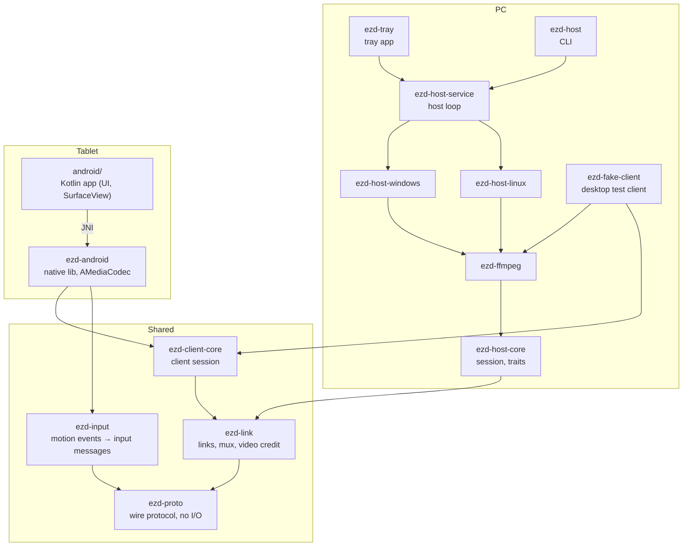
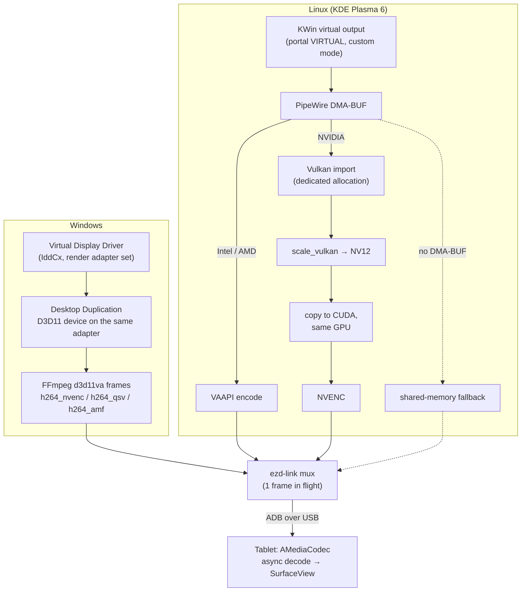

# ezdisplay architecture

ezdisplay turns an Android tablet into an extended monitor for a Windows or Linux PC, over USB (ADB now, Android Open Accessory later) or Wi-Fi. The design goal is low latency: about 30 ms glass to glass over USB at 120 Hz, with the cursor feeling instant.

## Why existing tools lag

On hybrid-GPU laptops (for example an Acer Nitro 5 with a MUX switch), existing second-screen apps create the virtual display on whatever adapter Windows picks, usually the iGPU. Windows rendered on the dGPU then have to be copied to the iGPU every frame. If encoding happens on the other GPU, every frame crosses PCIe again. The cursor is composited into the video, so it inherits the full pipeline latency.

## Core principles

1. **Same GPU for everything.** The virtual display is rendered, captured and encoded on one adapter, with no CPU or cross-GPU copies. By default this is the adapter that drives the primary display, except on Windows hybrid laptops, where the discrete GPU is used when it has a hardware encoder (its encoder reads the captured texture without a copy). The user can force the discrete GPU with "prefer dGPU" or pick any adapter explicitly. The host verifies the real adapter (LUID on Windows) and warns when it does not match.
2. **The cursor is drawn locally.** The cursor shape and position travel on their own channel and are drawn by the tablet on top of the video.
3. **Never queue video.** The link has a credit of one video frame. The host captures and encodes only when the previous frame has left. When the link is busy, frames are coalesced before encoding, never dropped after it.
4. **Low-latency codec settings at both ends.** No B-frames, CBR with a VBV of about one frame, an infinite GOP with keyframes on request, and decoder low-latency keys on Android (`KEY_LOW_LATENCY` plus vendor keys).
5. **Native mode.** The tablet's native resolution at its highest refresh rate, up to 120 Hz by default. `--scale` lowers the stream size to a fraction of it.

## Components

Arrows point from a crate to the crates it uses; dependencies already implied by another arrow are
left out. The platform backends are only built on their own OS.

| Crate / dir | Role |
|---|---|
| `crates/ezd-proto` | Wire protocol: framing, messages, capabilities negotiation, clock sync. Pure, no I/O. |
| `crates/ezd-link` | Byte-stream links (TCP/ADB now, AOA and QUIC later), ADB helper, prioritized mux with video credit. |
| `crates/ezd-host-core` | Platform-independent host: `VideoSource` / `VirtualDisplay` traits, session, pacing, synthetic frames. |
| `crates/ezd-ffmpeg` | Thin safe wrapper over FFmpeg (encoders, decoders, hardware contexts). |
| `crates/ezd-host-service` | The host loop as a library: accepts the tablet, keeps `adb reverse` set up for each device, runs sessions and publishes live status. Used by the CLI and the tray app. |
| `crates/ezd-host` | Host CLI: `run`, `diag`, `vdd` (driver status, setup, install, uninstall). |
| `crates/ezd-tray` | The PC app (`ezdisplay`): tray icon and menu plus a settings and statistics window (egui), autostart, single instance. |
| `crates/ezd-fake-client` | Desktop stand-in for the Android client (decode, latency stats, frame dumps). |
| `crates/ezd-host-linux` | Linux backends (Phase 1c): KDE and GNOME virtual outputs, PipeWire DMA-BUF, VAAPI/NVENC. |
| `crates/ezd-host-windows` | Windows backends (Phase 1d): Virtual Display Driver, DXGI adapter policy, Desktop Duplication, D3D11 encoders. |
| `crates/ezd-client-core` | Client session shared by the Android library and the fake client: handshake, receive loop, frame acks, clock sync, cursor cache. |
| `crates/ezd-input` | Client input engine: motion events to protocol input messages, palm rejection, S Pen button gestures, local zoom. |
| `crates/ezd-android` + `android/` | Android client: Kotlin UI, Rust native lib with AMediaCodec decode to a SurfaceView. |
| `packaging/windows` | Inno Setup installer: bundles the driver, `nefconw.exe` and `adb`, downloads the pinned FFmpeg build during setup. |
| `packaging/linux` | udev rule for `/dev/uinput`, desktop entry and icon; Arch `PKGBUILD`, Debian/Ubuntu `.deb` maintainer scripts (metadata in `crates/ezd-tray`) and the AppImage build (bundled FFmpeg and adb). |
| `tools/latency` | Web page for glass-to-glass measurements with a slow-motion camera. |
| `tools/input-test` | Web page and logger to check injected pen, touch, buttons and scroll as text. |

## Platform notes

The video path on each host, from the virtual output to the tablet's screen. Every box up to the
encoder runs on the same GPU:

### Windows

- Virtual display: [Virtual Display Driver](https://github.com/VirtualDrivers/Virtual-Display-Driver) (MIT, signed, IddCx). The `<gpu><friendlyname>` setting makes it call `IddCxAdapterSetRenderAdapter`. Configuration lives in `HKLM\SOFTWARE\MikeTheTech\VirtualDisplayDriver` (read first) or `C:\VirtualDisplayDriver\vdd_settings.xml`. Writing it needs elevation. The VDD path adds the `--scale`d mode the first time, which needs a writable `vdd_settings.xml`.
- Driver install: the installer runs `ezd-host vdd install`, which creates the root device node (`Root\MttVDD`) with nefcon, points `VDDPATH` at `C:\ProgramData\ezdisplay\vdd` and lets users write `vdd_settings.xml` there, so the host never needs elevation. A VDD installed separately is detected and left untouched. Uninstall removes the driver only when ezdisplay installed it.
- Capture: DXGI Desktop Duplication on the virtual output, using a D3D11 device on the same adapter. With the hardware cursor enabled, the pointer arrives separately.
- Encode: FFmpeg with d3d11va hardware frames (`h264_nvenc` / `h264_qsv` / `h264_amf`). A direct NVENC SDK backend is an option if FFmpeg buffers frames.
- Input (Phase 2): `InjectSyntheticPointerInput` with PT_PEN and PT_TOUCH devices.
- USB without developer mode (Phase 3): UsbDk filter driver (optional install), falling back to ADB.

### Linux

- KDE Plasma: the ScreenCast portal source type `VIRTUAL` creates a KWin virtual output. The user picks its size in the portal dialog, default 1920×1080, and `restore_token` skips the dialog afterwards. KWin virtual outputs start at 60 Hz but support custom modes, so the host adds the stream-size mode (the tablet's native size, or the `--scale`d one) with `kscreen-doctor output.<name>.addCustomMode.<w>.<h>.<mHz>.reduced` and switches to it.
- GNOME: Mutter's own `org.gnome.Mutter.ScreenCast` service. The host calls `CreateSession`, `RecordVirtual` (`cursor-mode` 2 = metadata, `is-platform`) and `Start`, waits for the `PipeWireStreamAdded` signal and captures that node from the user's PipeWire daemon (no portal, no dialog). Mutter sizes the virtual monitor from the PipeWire format negotiation, so the capture offers a size range anchored at the wanted size (`pw.rs`), and the host reads the result back from `org.gnome.Mutter.DisplayConfig.GetCurrentState` once the format is known. The monitor appears in `DisplayConfig` only after the stream connects, and Mutter places it to the right of the existing ones. Without the ScreenCast service on the bus (or to capture an existing monitor) the host falls back to the portal. wlroots (later): a headless output created over IPC, captured through Wayland protocols.
- Backend selection (`backend.rs`): `EZD_LINUX_BACKEND=kde|gnome|sway|hyprland`, then `XDG_CURRENT_DESKTOP`, then the bus names `org.kde.KWin` and `org.gnome.Mutter.ScreenCast`, then `SWAYSOCK` and `HYPRLAND_INSTANCE_SIGNATURE`. Sway and Hyprland are detected but report a clear error. The compositor-specific half is a `VirtualOutputProvider` (`provider.rs`: `open` creates the output and returns a `FrameSource`, `settle` reports the final output once the stream format is known; implemented by `kde.rs` and `gnome.rs`); `source.rs` holds the shared capture and encode core. `FrameSource` has only a PipeWire variant today; a producer that does not use PipeWire becomes another variant.
- Capture: PipeWire with DMA-BUF. Encoding uses VAAPI on Intel/AMD. On NVIDIA, the DMA-BUF is imported into Vulkan with a dedicated allocation (FFmpeg's own import makes some buffers sample as black there), converted to NV12 with `scale_vulkan`, copied into CUDA memory on the same GPU and encoded with NVENC. Shared memory is the fallback.
- The zero-copy paths need the encoder GPU to be the one KWin renders on. The host takes KWin's primary GPU from `KWIN_DRM_DEVICES` (its first entry) when it is set, and otherwise the GPU driving the internal panel.
- Input (Phase 2): uinput devices mapped to the virtual output (KWin `org.kde.KWin.InputDevice.outputName`, GNOME gsettings, Sway/Hyprland config). KDE and GNOME are implemented, see `docs/input.md`.

### Android

- SurfaceView, the highest refresh display mode, and `Surface.setFrameRate`. The decoder runs asynchronously and renders straight to the surface.
- `minSdk` 26; low-latency features are enabled on API 30+. Two flavors: `full` (GitHub) and `play` (Play Store policy-safe).

## Phases

0. Diagnosis and spikes (Nitro measurements, KDE virtual output, tablet probing).
1. Vertical slice on both hosts: video and local cursor over ADB. 1a core → 1b Android, 1c Linux KDE, 1d Windows in parallel.
2. Input: touch, pen, S Pen button gestures.
3. Transports: AOA, Wi-Fi (QUIC with PIN pairing).
4. Audio.
5. GNOME and wlroots backends.
6. Packaging: Windows installer (done, with the tray app), Linux packages (Arch, .deb, AppImage; done) and udev rules, Android `full`/`play` builds.
