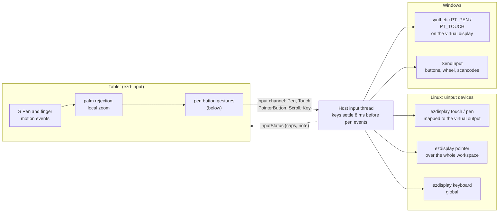
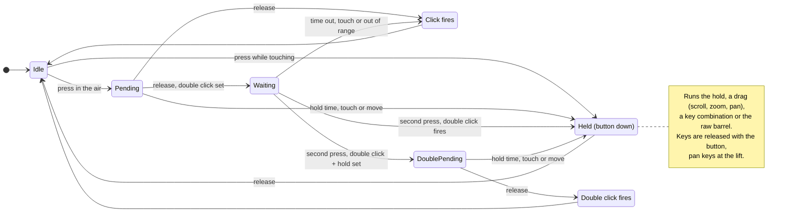
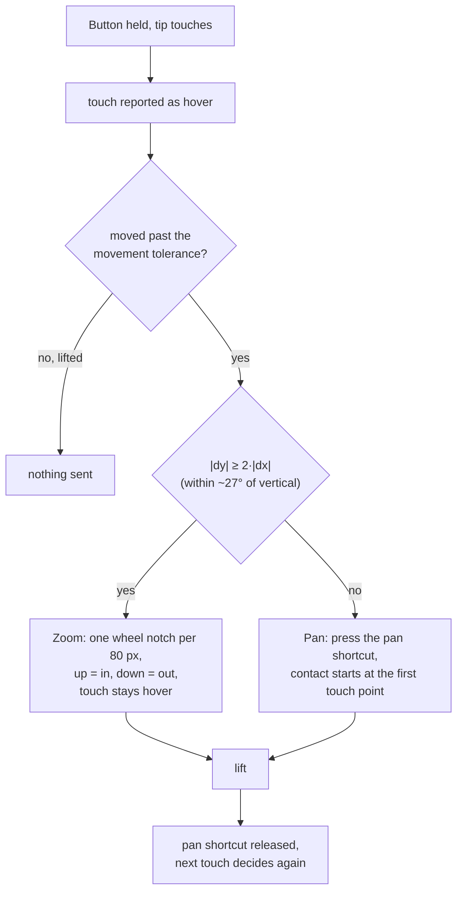

# Input injection

The tablet sends pen, touch, button, scroll and key events; the host injects them into the desktop.
`ezd-host run` does this by default; `--no-input` turns it off. Without a working backend the
stream still runs and the tablet is told why (`InputStatus.note`).



## Host flags

- `--no-input`: do not inject anything.
- `--telemetry`: ask the tablet to show its telemetry overlay. The host logs the input latency
  (p50 / p95 from the tablet event to the injection) every 5 s either way.
- `--pen-mode tablet|mouse`: inject the pen as a pen (default) or as an absolute mouse, for apps
  without pen support (see each platform below).

## Keyboard shortcuts on the pen button

Like a graphics-tablet driver, the tablet can send a key combination from the S Pen button (protocol 0.4,
`Key` messages). In the app's input settings:

- **Graphics tablet profile.** Holding the button keeps the combination pressed (Ctrl + Space by
  default) while the tip and hover reach the app as usual, so "hold the button and drag" works
  like on a graphics tablet. A quick click in the air is a right click and a double click toggles the local
  zoom. Ctrl + Space is a common drag-zoom shortcut in drawing apps; the combination can be changed in
  the app.
  Double click + hold (a second press within the double-click time, kept down) keeps a second
  combination pressed, Ctrl + Alt + Space by default, a common zoom-out shortcut in drawing apps. A quick
  double click keeps its action (local zoom), now fired when the button is released.
- **Custom profile.** Click, double click and hold can each tap or hold their own combination.
  With hold = shortcut, the two drag triggers are ignored. Double click + hold (off by default) can hold
  its own combination or switch to the eraser; it only applies when click and double click are both set.

The hold, and the second press of a double click + hold, are resolved at the first of: the hold time,
the tip touching, or the pen moving in hover (a release before that is a plain click or double click).
The keys are released when the button is released, when the pen leaves range and when the session
ends, so a key cannot stay stuck on the PC.

How a button press resolves:



When a drag is configured, the hold time alone does not fire the hold: the press waits for a drag or the
release. With the view locally zoomed, moving in the air with the button held pans the view.

### Zoom in steps

Some drawing apps have no wheel or continuous zoom: their zoom is a shortcut plus a click (for example Ctrl + Space
and a click zooms in, Ctrl + Alt + Space and a click zooms out). In the Custom profile, set "Zoom in steps" on
"Hold + drag touching" and/or "Hold + move in the air": hold the button, then drag up to zoom in or down to zoom
out. For every 80 view pixels of vertical travel (horizontal travel is ignored) the tablet taps the zoom shortcut
and clicks the left button, then releases the shortcut, all at the point where the drag started, because these
apps zoom around the click. Steps are at least 60 ms apart and at most three are queued, so a long fast drag
stays bounded. While the drag lasts the tip touch reaches the PC as hover, so nothing is drawn. The two shortcuts
(Ctrl + Space and Ctrl + Alt + Space by default) are edited in the app; with one of them empty, steps in that
direction do nothing. If hold is set to a shortcut, the drags are ignored as usual.

### Zoom with the wheel, in steps

Some drawing apps zoom one level per mouse wheel message, whatever its size, so the continuous scroll zoom is
far too fast. In the Custom profile, set "Zoom with the wheel, in steps" on "Hold + drag touching" and/or
"Hold + move in the air": hold the button, then drag up to zoom in or down to zoom out. For every 80 view pixels
of vertical travel (the same step distance, 60 ms gap and queue of three as "Zoom in steps") the tablet sends
exactly one wheel notch, up or down, at the point where the drag started. No keys or clicks are sent. While the
drag lasts the tip touch reaches the PC as hover.

### Pan the canvas

Many drawing apps pan the canvas with Space and a drag. In the Custom profile, set "Pan the canvas" on
"Hold + drag touching" (it is not available in the air): hold the button and touch with the tip. The pan
shortcut (Space by default, edited in the app) is pressed before the contact reaches the PC, then the pen is
forwarded as usual, so the app sees the shortcut plus a drag. The shortcut is released after the tip lifts; if
the button is released first, the shortcut stays down until the lift. It is also released when the pen leaves
range, on cancel and when the session ends. The pan starts at the touch, without waiting for the drag
distance. If hold is set to a shortcut, the drags are ignored as usual.

### Pan or zoom with one drag

"Pan or zoom" on "Hold + drag touching" (Custom profile, not available in the air) works like the pan/zoom
button of a graphics-tablet driver: hold the button, touch and drag. The touch is first reported as hover. Once
the pen has moved farther than the movement tolerance from the touch point, the direction decides, once, until
the lift: a mostly vertical drag (within about 27 degrees of vertical) zooms like "Zoom with the wheel, in
steps" (the travel from the touch point counts, so the first step is not delayed), and any other drag pans like
"Pan the canvas": the pan shortcut is pressed, the contact starts at the point where the tip first touched,
and the shortcut is released after the lift. A touch that never leaves the tolerance does nothing. With an
empty pan shortcut the pan branch just forwards the contact. If the button is released mid-touch the mode
stays until the lift (the pan shortcut stays down, a zoom just stops, and an undecided touch stays hover).



### Button pressed while touching

For "Pan the canvas" and "Pan or zoom" the button may also be pressed while the tip already touches (for
example while drawing). The stroke ends with a lift sample, then the drag goes on as if the tip had just
touched with the button held: Pan presses its shortcut and continues the contact from the current point, Pan or
zoom starts deciding from the current point. The real lift later sends nothing extra. For every other
configuration the button pressed while touching is still forwarded as is. A shortcut hold still wins.

Keys are physical positions (USB HID usages of a US keyboard); the PC applies its own layout, as
with a real USB keyboard. The host announces the `KEYS` capability; an older host does not, and
the tablet then drops the keys and says the host needs an update.

Because the keyboard and the pen are separate devices, the host waits up to 8 ms after a key press
before injecting the next pen or pointer event, so the app sees the keys first. `EZD_KEY_SETTLE_MS`
changes the wait (0 turns it off).

**Drawing apps on Windows:** some read pressure only through Windows Ink; pick the Windows Ink
(Windows API) option instead of Wintab in their tablet settings.

## Linux (KDE Plasma 6)

### What the host creates

Four uinput devices per session, all with vendor `0x1209` and fixed names, so KWin can remember
their settings:

| Device | Product | Kind | Used for |
| --- | --- | --- | --- |
| `ezdisplay touch` | `0xEDD1` | multi-touch screen (type B, up to 10 contacts, `INPUT_PROP_DIRECT`) | finger touch |
| `ezdisplay pen` | `0xEDD2` | graphics tablet (pressure, tilt, eraser, barrel button) | stylus |
| `ezdisplay pointer` | `0xEDD3` | absolute pointer with buttons, wheel and Ctrl / Shift | mouse-style buttons, scrolling, pinch (Ctrl + wheel) |
| `ezdisplay keyboard` | `0xEDD4` | keyboard (letters, digits, function, navigation and modifier keys) | keyboard shortcuts of the pen button |

The ranges are the protocol's 0..65535, with the resolution derived from the tablet's pixel size
and dpi. Keyboards are global in KWin, so the keyboard is not mapped to an output. The devices
disappear when the session ends.

### Permissions

`/dev/uinput` is `root:root 0600` by default. Install the udev rule once:

```sh
sudo install -m644 packaging/linux/70-ezdisplay-uinput.rules /etc/udev/rules.d/
sudo udevadm control --reload && sudo udevadm trigger --name-match=uinput
```

The rule gives the user at the seat access (the `uaccess` tag). Its file name sorts before
`73-seat-late.rules`, which is required. `ezd-host diag` reports `input.uinput` as `ok`,
`permission denied` or `missing` (load the module with `sudo modprobe uinput`).

### Mapping to the virtual output

KWin ignores touch and tablet devices that have no output. After creating the devices, the host
sets `outputName` of the touch and pen devices to the virtual output over D-Bus
(`org.kde.KWin.InputDevice` at `/org/kde/KWin/InputDevice/eventN`, session bus) and reads it back.
Touch and pen are only enabled once this worked; otherwise `InputStatus` omits them and says why.
KWin stores the mapping in `~/.config/kcminputrc` under
`[Libinput][4617][60881][ezdisplay touch]` (decimal vendor / product) and similar; the host sets it
again every session because the virtual output is new each time. These groups can be deleted safely.

The pointer is different: KWin scales an absolute pointer over the whole workspace (the bounding
box of the enabled outputs, in logical coordinates). The host reads the layout with
`kscreen-doctor -j`, refreshes it every 3 s and converts the stream position to that space,
including the output's scale. If the workspace does not start at (0, 0) (an output to the left of
or above the primary one) the pointer is off by that offset; the host logs a warning once.

### Pen button and `--pen-mode`

- Qt and Xwayland map `BTN_STYLUS` to middle click and `BTN_STYLUS2` to right click. The barrel
  button sends `BTN_STYLUS2` by default (barrel + tip = right click). Set `EZD_PEN_BUTTON=stylus`
  for `BTN_STYLUS`.
- Only Wayland clients with `zwp_tablet_v2` support (Qt, GTK, Firefox, Xwayland) see the pen, and
  a tablet does not move the system pointer. For apps without tablet support use
  `ezd-host run --pen-mode mouse`: the pen drives the pointer device instead (move, tip = left
  button, barrel = right button, no pressure or tilt).

### Troubleshooting

- `ezd-host diag`: the `input` section shows `uinput` and `kwin_input_dbus`.
- `busctl --user tree org.kde.KWin` lists `/org/kde/KWin/InputDevice/eventN` for each device;
  `busctl --user introspect org.kde.KWin /org/kde/KWin/InputDevice/eventN` shows `outputName`.
- `libinput list-devices` shows whether the touch device is a touchscreen and the pen a tablet.
- `wev` (or `libinput debug-events`) shows the events a client receives, including which button the
  barrel produces.
- "cannot open /dev/uinput (permission denied)": install the udev rule and re-login or re-trigger.
- Touch works but lands on the wrong screen: check `outputName` of the device; the note in the
  tablet's status says if the mapping failed.

## Linux (GNOME)

The same four uinput devices are created; only the mapping differs. Mutter reads the output of a
touchscreen or tablet from gsettings, in relocatable schemas keyed by `<vendor>:<product>` (lowercase
hex):

| Device | Schema and path |
| --- | --- |
| touch | `org.gnome.desktop.peripherals.touchscreen:/org/gnome/desktop/peripherals/touchscreens/1209:edd1/` |
| pen | `org.gnome.desktop.peripherals.tablet:/org/gnome/desktop/peripherals/tablets/1209:edd2/` |

The key is `output`, type `as`, and its value is the monitor's EDID triple
`['vendor', 'product', 'serial']` (`['', '', '']`, the default, means automatic mapping; the schema documents
no other form). For the virtual monitor Mutter reports `MetaVendor`, `Virtual remote monitor` and a
serial that changes with every new monitor (`0x000001`, ...), so the host reads the triple from
`org.gnome.Mutter.DisplayConfig` for the new monitor and sets both keys with `gsettings` every
session. It remembers the previous values and puts them back (a `reset` when they were the default)
when the session ends. Touch and pen are only enabled once this worked.

The pointer is an absolute device over the whole desktop. The host reads the layout from
`DisplayConfig` (`layout-mode` physical or logical, scale and rotation included), refreshes it every
3 s and converts the stream position the same way as on KDE. `ezd-host diag` reports the Mutter
version and whether the `ScreenCast` and `DisplayConfig` services answer (`gnome` section).

Check the mapping with `gsettings get <schema>:<path> output`, and with `libinput list-devices`.
The mapping has been verified to be written and restored against a headless Mutter
(`tools/gnome-headless-test.sh`); a headless Mutter has no input seat, so touch and pointer routing
still needs a check on a real GNOME session.

## Windows

The Windows host injects the pen and touch through synthetic pointer devices (`CreateSyntheticPointerDevice`, Windows 10 1809 or later): a PT_PEN device with pressure, tilt, barrel button and eraser, and a PT_TOUCH device with up to 10 contacts. Pointer buttons and scrolling go through `SendInput`, as absolute mouse moves over the virtual desktop followed by the click or wheel. Ctrl and Shift are pressed around the wheel event, so a pinch (Ctrl + wheel) zooms.

- **Coordinates.** Normalized coordinates are mapped onto the pixel rectangle of the virtual display, read from its GDI name (`dmPosition` plus current size). The rectangle is re-read when the pen enters range and at most once per second otherwise. The process is per-monitor-v2 DPI aware, so these are physical pixels.
- **Pen.** Hover is INRANGE|UPDATE, DOWN and UP are injected as separate frames, and leaving range is an UPDATE without INRANGE. Pressure is scaled to 0..1024 and tilt to -90..90 degrees. The barrel button sets `PEN_FLAG_BARREL`. The eraser end sets `PEN_FLAG_INVERTED` while in range, plus `PEN_FLAG_ERASER` while in contact. Changing between pen and eraser leaves range and enters again.
- **Touch.** Every injection lists all active contacts. Stationary contacts are re-injected as UPDATE after 100 ms without any touch injection, and a contact missing from a frame is lifted.
- **Keys.** Keyboard shortcuts are injected with `SendInput` as scancodes (`KEYEVENTF_SCANCODE`, plus `KEYEVENTF_EXTENDEDKEY` for arrows, navigation keys and the Windows keys), so they behave like a physical keyboard under the user's layout. Held keys are released when the session ends.
- **Mouse pen mode** (`--pen-mode mouse`). No pen device is created. The pen moves the mouse, contact is the left button, the barrel button is the right button, and leaving range releases them.
- **Limits.** Windows blocks injected input to windows of an elevated (administrator) process (UIPI) unless the host also runs elevated. The tray app therefore runs elevated by default on Windows (through its `ezdisplay` scheduled task, so there is no UAC prompt at launch); the *Control administrator windows (run elevated)* setting turns that off. `ezd-host run` from a normal terminal is not elevated. The host logs a rate-limited warning when `SendInput` injects fewer events than requested.
- **Status.** `InputStatus` always carries ACTIONS and KEYS, and TOUCH and PEN only when their device was created. If a device cannot be created (Windows older than 1809), the note says so. Without a known virtual display, input is unavailable. `ezd-host diag` has an `input` section that reports whether both devices can be created.
