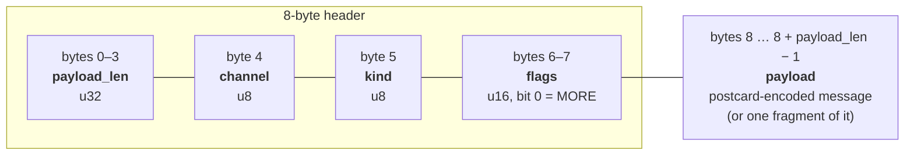
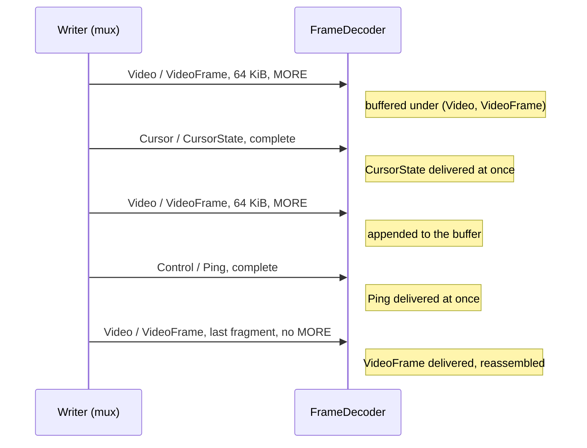
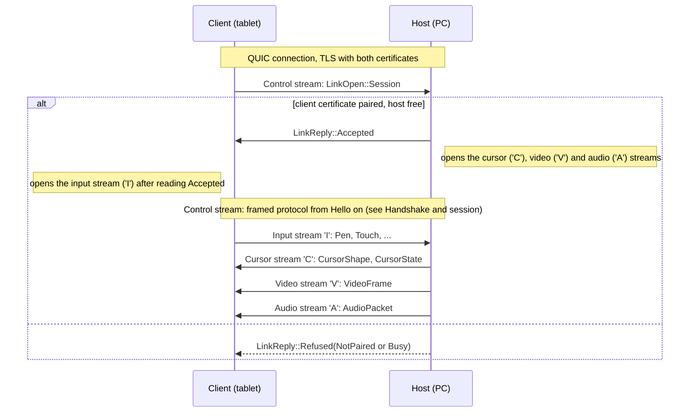
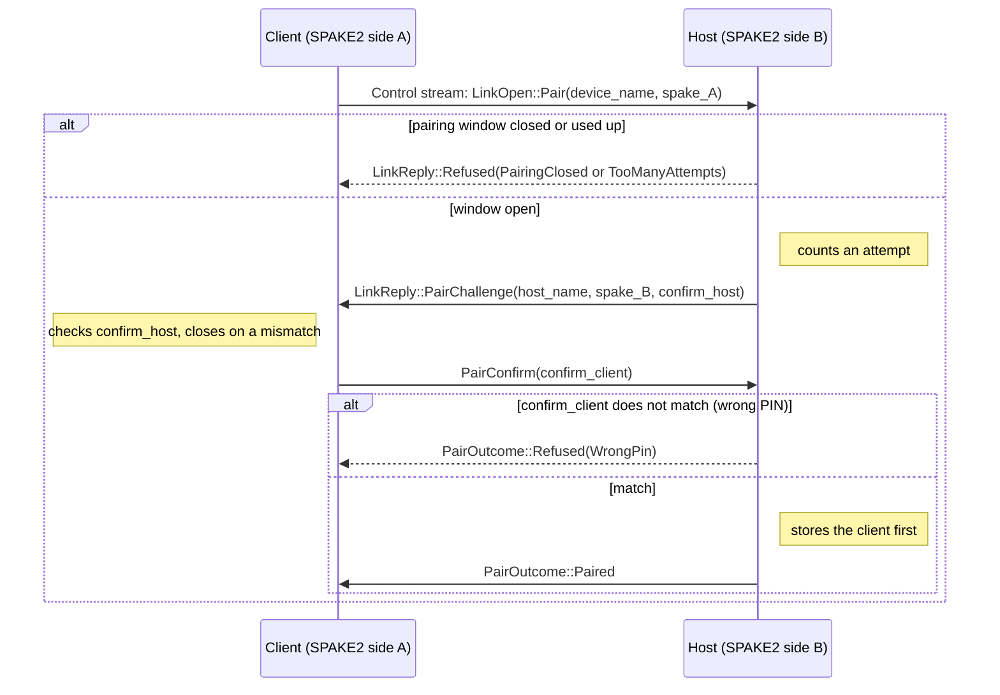
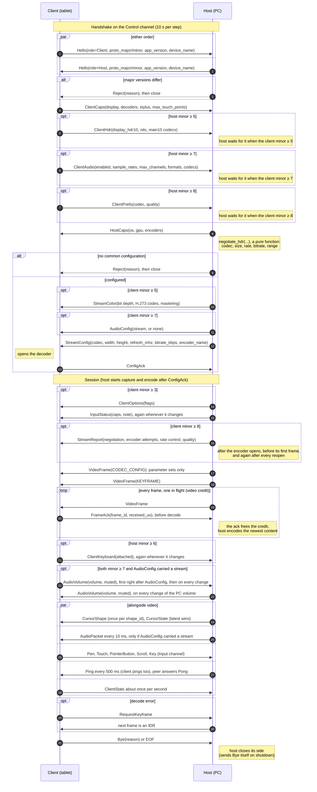
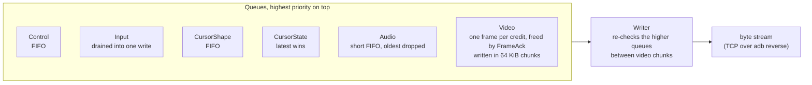
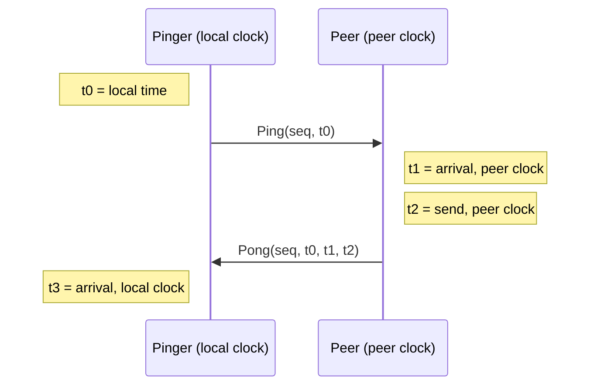

# ezdisplay wire protocol (version 0.8)

All integers are little endian. The protocol runs over any reliable ordered byte stream: TCP
through `adb reverse` over USB, or a QUIC connection on Wi-Fi (see [Transports](#transports)). It is implemented in the `ezd-proto`
crate (messages, framing) and `ezd-link` (prioritized mux).

## Framing

Every frame is an 8-byte header followed by `payload_len` bytes of payload.



| Field | Meaning |
| --- | --- |
| `payload_len` | Payload length in bytes, at most `MAX_FRAME_LEN` = 16 MiB. A larger value is a fatal protocol error. |
| `channel` | Logical channel, see below. |
| `kind` | Message type within the channel. |
| `flags` | Bit 0 `MORE`: this frame is a fragment and the message continues in a later frame with the same `(channel, kind)`. Other bits are reserved and must be ignored. |

### Channels

| Id | Name | Use |
| --- | --- | --- |
| 0 | Control | Handshake, capabilities, keepalive, statistics. |
| 1 | Input | Pen, touch, pointer buttons, scroll and keys, client to host (0.3; keys 0.4). |
| 2 | Cursor | Cursor shape and position. |
| 3 | Video | Encoded video frames. |
| 4 | Audio | PC audio packets, host to client (0.7). |

### Kinds

| Channel | Kind | Message | Direction | Payload |
| --- | --- | --- | --- | --- |
| Control | 1 | `Hello` | both | postcard |
| Control | 2 | `ClientCaps` | client to host | postcard |
| Control | 3 | `HostCaps` | host to client | postcard |
| Control | 4 | `StreamConfig` | host to client | postcard |
| Control | 5 | `ConfigAck` | client to host | empty |
| Control | 6 | `Ping` | either | postcard |
| Control | 7 | `Pong` | either | postcard |
| Control | 8 | `RequestKeyframe` | client to host | empty |
| Control | 9 | `ClientStats` | client to host | postcard |
| Control | 10 | `Reject` | either | postcard |
| Control | 11 | `Bye` | either | postcard |
| Control | 12 | `FrameAck` | client to host | postcard |
| Control | 13 | `InputStatus` | host to client | postcard (0.3) |
| Control | 14 | `ClientOptions` | host to client | postcard (0.3) |
| Control | 15 | `ClientHdr` | client to host | postcard (0.5) |
| Control | 16 | `StreamColor` | host to client | postcard (0.5) |
| Control | 17 | `ClientKeyboard` | client to host | postcard (0.6) |
| Control | 18 | `ClientAudio` | client to host | postcard (0.7) |
| Control | 19 | `AudioConfig` | host to client | postcard (0.7) |
| Control | 20 | `AudioVolume` | both directions | postcard (0.7) |
| Control | 21 | `StreamReport` | host to client | postcard (0.8) |
| Control | 22 | `ClientPrefs` | client to host | postcard (0.8) |
| Input | 1 | `Pen` (`PenSample`) | client to host | postcard (0.3) |
| Input | 2 | `Touch` (`TouchFrame`) | client to host | postcard (0.3) |
| Input | 3 | `PointerButton` | client to host | postcard (0.3) |
| Input | 4 | `Scroll` | client to host | postcard (0.3) |
| Input | 5 | `Key` | client to host | postcard (0.4) |
| Cursor | 1 | `CursorShape` | host to client | postcard |
| Cursor | 2 | `CursorState` | host to client | postcard |
| Video | 1 | `VideoFrame` | host to client | postcard |
| Audio | 1 | `AudioPacket` | host to client | postcard (0.7) |

The payload of a message is the [postcard](https://docs.rs/postcard) encoding (serde, varint
integers, no field names) of the struct of that name in `ezd-proto/src/msg.rs`. Byte vectors
(`VideoFrame.data`, `CursorShape.rgba`, `AudioPacket.data`, `AudioStream.codec_config`) use `serde_bytes`, i.e. a varint length followed by
raw bytes. The struct definitions are the normative field list and order.

### Fragmentation and reassembly

A message whose payload exceeds the writer's chunk size (default 64 KiB) is split into several
frames. Every fragment except the last carries `MORE`; the last one does not. The receiver
concatenates the payloads of all frames of one `(channel, kind)` until a frame without `MORE`.

Complete frames (and fragments of other `(channel, kind)` pairs) may be interleaved between
the fragments of a message. This is how a cursor update overtakes a large keyframe; reassembly
is therefore keyed by `(channel, kind)`. The fragments of one key stay in order. A reassembled
message must not exceed `MAX_MESSAGE_LEN` = 32 MiB.



The IO-free `FrameDecoder` accepts bytes in arbitrary pieces (one byte at a time or many frames
per push) and yields complete messages.

### Forward compatibility

* A `(channel, kind)` pair the receiver does not know is skipped silently (it is reassembled,
  counted and dropped), never an error. A peer older than a channel simply skips its messages.
* Unknown flag bits are ignored.
* A known pair with a malformed payload is a protocol error and the connection should be
  closed. Because postcard is not self-describing, existing structs are never extended in
  place within a major version: new data gets a new `kind`.

### Versioning

`Hello` carries `proto_major` and `proto_minor` (currently 0 and 8; 0.2 added `FrameAck`, 0.3
the input messages, `InputStatus` and `ClientOptions`, 0.4 the `Key` message, 0.5 `ClientHdr` and
`StreamColor` for HDR10, 0.6 `ClientKeyboard`, 0.7 `ClientAudio`, `AudioConfig`, `AudioVolume` and the Audio channel for
PC audio, 0.8 `StreamReport` and `ClientPrefs`; the Wi-Fi transport is below the framed protocol and
needs no minor bump). A different major version is fatal: the
receiver answers `Reject` and closes. Minor versions only add new `(channel,
kind)` pairs, so peers with different minors interoperate. `Hello::supports_input()` is true
when the peer's minor is at least `MINOR_INPUT` = 3; a host must not send `InputStatus` or
`ClientOptions` to an older client (it would skip them anyway), and a client must not send
Input messages to an older host. `Key` needs no minor gate: a client sends it only when the
host's `InputStatus.caps` has `KEYS`, and an older host would skip the unknown pair anyway.
`Hello::supports_hdr()` is true when the peer's minor is at least `MINOR_HDR` = 5: a client sends
`ClientHdr` only to such a host, and a host sends `StreamColor` only to such a client.
`Hello::supports_audio()` is true when the peer's minor is at least `MINOR_AUDIO` = 7: a client
sends `ClientAudio` only to such a host (and only if it advertised such a minor itself), and a
host sends `AudioConfig` and `AudioPacket` only to such a client. A peer with an older minor sees
no audio message at all.
`Hello::supports_keyboard()` is true when the peer's minor is at least `MINOR_KEYBOARD` = 6: a
client sends `ClientKeyboard` only to such a host.
`Hello::supports_report()` and `Hello::supports_stream_prefs()` are true when the peer's minor is at
least `MINOR_STREAM_PREFS` = 8: a host sends `StreamReport` only to such a client, and a client
sends `ClientPrefs` only to such a host.

## Transports

### USB (TCP through `adb reverse`)

The host listens on `127.0.0.1:27183` and `adb reverse` maps the tablet's `127.0.0.1:27183` to
it. Everything goes over one TCP stream in the order described in [Priority](#priority). The
link is not encrypted; it never leaves the loopback interface and the USB cable.

### Wi-Fi (QUIC)

The host listens on UDP `0.0.0.0:27183` with QUIC (TLS 1.3 only, ALPN `ezd/0`). Both sides
present a long-lived self-signed certificate (ECDSA P-256) and identify each other by its
fingerprint, the SHA-256 of the certificate DER. There is no CA: the client pins the host's
fingerprint, and the host only starts sessions for fingerprints it has paired with.

Streams, one per channel:

| Stream | Kind | Opened by | Tag | Send priority |
| --- | --- | --- | --- | --- |
| Control | bidirectional | client | none (preamble first) | 4 (highest) |
| Input | unidirectional | client, after reading `Accepted` | `'I'` | 3 |
| Cursor | unidirectional | host, after writing `Accepted` | `'C'` | 2 |
| Audio | unidirectional | host, after writing `Accepted` | `'A'` | 1 |
| Video | unidirectional | host, after writing `Accepted` | `'V'` | 0 (lowest) |

Every unidirectional stream starts with its tag byte, then carries the framed messages of its
channel. Control carries the preamble, then the framed protocol for the control channel. The
receiver accepts the expected streams (the host one, the client three) within 10 s and dispatches
them by tag, not by arrival order; an unknown or repeated tag ends the session. The audio stream
is optional for compatibility: the host gives up opening it after 0.5 s (a client older than
0.7 allows only two), and the client waits 0.5 s for it after the cursor and video streams (a
host older than 0.7 never opens it); a link without the audio stream carries no audio. The cursor stream
carries cursor shapes and the latest-wins cursor state, shapes first. There is no compatibility
with earlier layouts.

Each channel has its own stream so a lost packet on one never holds back another: a lost packet
of a large video frame does not delay input, cursor or control messages. Every other rule of
this document (credit, coalescing, reassembly) is unchanged; each stream is reassembled on its
own, and the priorities above are QUIC send priorities between the streams.

Before the framed protocol the client sends one preamble message (`ezd_proto::pair`). Preamble
messages are postcard with a `u16` little-endian length prefix, at most 1024 bytes, and each
step must complete within 10 s.



Transport settings tuned for latency: keep-alive 1 s, idle timeout 5 s, initial RTT estimate
10 ms. The congestion controller is Cubic; BBR can be selected for experiments.

The host accepts any client certificate in the handshake, so it treats every peer as untrusted
until the preamble: it finishes each handshake in its own task within 10 s, keeps at most 8
connections, allows the client one bidirectional stream and one unidirectional one (input), and uses
256 KiB receive windows (it never receives video). The client allows the host only the cursor,
video and audio streams and uses 8 MiB stream and 16 MiB connection receive windows, room for a large keyframe.
A client only opens a session on a connection whose host certificate it pinned.

Hosts advertise themselves over mDNS as `_ezdisplay._udp.local.` with TXT records `fp` (short
fingerprint, see below), `name` and `pv` (protocol major version). The client can also be given
an address by hand.

### Pairing

A client that is not paired yet asks the host to pair while the host's pairing window is open.
The host shows a random 6-digit PIN, and a QR code of

```
ezd://pair?a=<ip:port>&fp=<host fingerprint, 64 hex digits>&pin=<PIN>&n=<host name, percent-encoded>
```

With the QR code the client pins `fp` before connecting. With a typed PIN it accepts any host
certificate for this one connection; the PIN exchange below then authenticates the
certificates of both sides.



* SPAKE2 over Ed25519 with the PIN as the password and the identities `ezdisplay client` (A)
  and `ezdisplay host` (B). The shared key `K` only matches if both sides used the same PIN; a
  passive observer learns nothing about the PIN and an active attacker tests one guess per
  attempt.
* Each confirmation is an HMAC-SHA256 with a per-side key `HMAC(K, side)` (`side` is
  `host confirm` or `client confirm`) over the transcript
  `"ezd-pair-v1" || exporter || host_fp || client_fp`. `exporter` is the 32-byte TLS keying
  material exporter value for the label `EXPORTER-ezd-pair-v1`, so the confirmation is bound to
  this TLS connection and both certificates: a machine in the middle running two TLS
  connections cannot relay it.
* The window allows 5 attempts and stays open 5 minutes; it closes after a successful pairing,
  so at most one device pairs per window. An attempt that started before the window was
  closed, reopened or expired is refused at the end even with the right PIN.
* Known limit: anyone on the network can use up the 5 attempts of an open window, which then
  has to be reopened. The PIN stays safe (5 guesses out of a million per window); only pairing
  is delayed.
* Both sides then store the other's fingerprint and name. Later connections open a session
  directly. The pairing connection itself is closed; the client reconnects for the session.

People compare fingerprints in a short form: the first 8 bytes as hex in 4 groups
(`3f2a-91c0-77de-0b14`).

## Handshake and session



Cursor messages may arrive any time after `StreamConfig`; a client must tolerate cursor traffic
before its first video frame. Handshake messages are answered within a few seconds or the peer
gives up (the host uses 10 s per step).

### Negotiation (`ezd_proto::negotiate`)

* Codec: H.264 unless the preferences ask for another codec and both sides support it
  (fallback order H.264, HEVC, AV1 among codecs both sides share).
* Decoder: hardware and low-latency preferred; its limits constrain the stream.
* Resolution: the client's native size, first scaled by the host's `--scale` (default 1.0), then
  scaled down (aspect preserved) to the decoder limits, rounded down to even numbers.
* Refresh rate: the highest client rate not above `max_refresh_mhz` (default 120000) and the
  decoder `max_fps`. The encoder frame rate equals the refresh rate.
* Bitrate: `width * height * fps * 0.07` bit/s for H.264 (`0.05` for HEVC and AV1), clamped to
  the link ceiling (USB 80 Mbit/s, network 30 Mbit/s by default). The bitrate is the encoder's
  target, not a constant rate: the host encodes at constant quality (NVENC `cq` 19, x264 `crf` 20,
  VAAPI VBR or fixed QP 20) with a peak of twice the bitrate and a VBV buffer of four frames at
  that peak, so the first IDR is sharp and still content costs few bits. The high and lossless
  quality levels (see Stream preferences) replace this with a fixed quantiser and no rate limit.
* Encoder: the first hardware encoder for the codec, otherwise the first software one.
* Dynamic range (`pick_dynamic_range`, used through `negotiate_hdr`): HDR10 is streamed only when
  the source is HDR, `Prefs.hdr` is not `Off`, the client sent `ClientHdr` with
  `display_hdr10` and a 10-bit decoder, and the host can encode 10 bits for a shared codec. HEVC
  is preferred, AV1 is used when HEVC is not shared. The HDR10 codec overrides the codec choice
  above and `StreamConfig.codec` matches it. Otherwise the stream is SDR and an HDR source is
  tone-mapped, for one reason of: turned off, old client, display not HDR, no 10-bit decoder,
  no 10-bit encoder.

* Audio (`negotiate_audio`): see [Audio](#audio-07).

## Video

`VideoFrame { frame_id, flags, capture_us, encoded_us, data }`. `data` is an Annex-B bitstream
for H.264 and HEVC. `flags`: bit 0 `KEYFRAME`, bit 1 `CODEC_CONFIG`.

### Codec-config rule

A `CODEC_CONFIG` frame contains only parameter sets (SPS and PPS; VPS as well for HEVC) in
Annex-B form. The host sends one before the first keyframe of a session and again whenever the
parameter sets change. The client hands it to its decoder as codec-specific data (on Android,
`MediaCodec` configuration or a buffer flagged `BUFFER_FLAG_CODEC_CONFIG`) before decoding the
keyframe that follows. `frame_id` of a config frame equals that of the frame sent right after it.
Keyframes may additionally carry the parameter sets in-band.

### Video credit and coalescing

Encoded frames are never dropped: dropping a P-frame corrupts every following picture. Instead
the host applies back-pressure before capture/encode:

1. the sender asks the mux for a video slot (`wait_video_slot`). It resolves only when no video
   frame is queued or being written **and** fewer than `window` frames are written but not yet
   acknowledged by the client (default window: 1);
2. only then it pulls the **newest** captured content, encodes it and sends it.

The credit is therefore released by the client, not by the socket write: the client sends
`FrameAck { frame_id, received_us }` (`received_us` on the client clock) as soon as a
non-config `VideoFrame` is fully reassembled, **before** decoding. An ack for id N releases N
and every outstanding id below N. `CODEC_CONFIG` frames are never acked and hold no credit.
If no ack arrives within the timeout (default 500 ms) the host releases the credit anyway,
counts an `ack_timeout` and logs a warning, so a client that never acks runs at about 2 fps
instead of stalling. Clients must therefore send acks.

When clock sync has an offset, the host maps `received_us` to its own clock and subtracts the
frame's `encoded_us` to get the link transfer time, reported as p50/p95.

If the link is slower than the display refresh rate, intermediate screen states are never
encoded, and `frame_id` skips numbers (it is strictly increasing but not contiguous). A
`CODEC_CONFIG` frame and the keyframe after it are queued back to back and share one credit.
The host may also be configured with write-based credit (freed when the write completes),
which is only meant for tests.

### Priority

The writer serves queues in the order control, input, cursor shapes, cursor state, audio, video.
Video frames are written in chunks and the higher-priority queues are re-checked between
chunks, so a large keyframe delays a control, input or cursor message by at most one chunk
(64 KiB by default). `CursorState` is latest-wins: a state that has not been written yet is
replaced by a newer one. Everything else is reliable FIFO. Note that control messages overtake
video: send `Bye` after the last frame has been written if the peer should see all frames first.

Audio is a short FIFO: when more than 10 audio packets (about 100 ms) are queued, the oldest
is dropped and counted (`audio_dropped`), so a stalled link replays no stale sound.



Input is batched: when the writer takes input it drains every queued input message into one
buffer and writes and flushes it once. Under a backlog (128 or more queued input messages) a
new `Pen` replaces the last queued message if that is a `Pen` with identical `flags`, and a new
`Touch` whose contacts are all `MOVE` replaces the last queued message if that is also an
all-`MOVE` `Touch` with the same set of ids. Transitions (any pen flag change, `DOWN`, `UP`,
`CANCEL`, buttons, scrolls) are never dropped.

## Input (0.3)

All input messages travel client to host on the Input channel and carry `t_us`, the client's
monotonic clock (same epoch as the other client timestamps). Coordinates `x`, `y` are `u16`
normalized over the stream: 0 is the left/top edge and 65535 (`NORM_MAX`) the right/bottom edge
(`normalize(px, extent)` and `denormalize(v, extent)` convert). Codes and flag bits are plain
integers, not enums: receivers ignore unknown codes and bits.

`Pen(PenSample { t_us, x, y, pressure, tilt_x, tilt_y, flags })`, one message per sample.
`pressure` 65535 = 1.0. Tilt is in hundredths of a degree (-9000..=9000); positive `tilt_x` =
top of the pen tilted to the right, positive `tilt_y` = tilted toward the user. `flags`:
`IN_RANGE` = 1, `CONTACT` = 2, `BARREL` = 4, `ERASER` = 8. A sample without `IN_RANGE` means
the pen left proximity.

`Touch(TouchFrame { t_us, contacts })`, with `TouchContact { id: u8, x, y, phase: u8 }` and
phases `DOWN` = 0, `MOVE` = 1, `UP` = 2, `CANCEL` = 3. Every frame lists ALL active contacts;
a contact that ended in this frame appears once with `UP` or `CANCEL` and is absent afterwards.

`PointerButton { t_us, x, y, button: u8, pressed: bool }` with `LEFT` = 0, `RIGHT` = 1,
`MIDDLE` = 2.

`Scroll { t_us, x, y, dx: i32, dy: i32, modifiers: u8 }`. Deltas are in 1/120 of a notch with
the signs of Windows `WHEEL_DELTA` and evdev `REL_WHEEL`/`REL_HWHEEL`: `dy > 0` = wheel rotated
forward, away from the user (scroll up; zoom in with Ctrl), `dx > 0` = right. `modifiers`:
`CTRL` = 1, `SHIFT` = 2.

`Key { t_us, usage: u16, pressed: bool }` (0.4). `usage` is a USB HID keyboard-page (0x07)
usage id, i.e. a physical key position on a US layout; the host applies the user's layout like a
real USB keyboard. Modifiers are plain keys (`LEFT_CTRL` = 0xE0, `LEFT_SHIFT` = 0xE1, `LEFT_ALT` =
0xE2, `LEFT_GUI` = 0xE3; `SPACE` = 0x2C). A key stays pressed until its release is sent, so a
client releases everything it pressed before it disconnects. Clients send `Key` only when the
host reports the `KEYS` capability.

Host to client, on the Control channel: `InputStatus { caps: u32, note: String }` with `caps`
bits `TOUCH` = 1, `PEN` = 2, `ACTIONS` = 4, `KEYS` = 8 (what the host can inject) and a human-readable
`note` explaining what is unavailable (empty when all is fine); `ClientOptions { flags: u32 }`
with `TELEMETRY` = 1 (show the telemetry overlay).

### Hardware keyboard (0.6)

Client to host, on the Control channel: `ClientKeyboard { attached: bool }`, sent right after the
handshake (when the host minor is at least 6) and whenever a hardware keyboard is attached or
detached on the client. The host may use it to adapt its desktop; the Windows host stops the touch
keyboard from popping up while `attached` is true and restores the setting when it becomes false or
the session ends. A host that does not care ignores it.

### HDR10 (0.5)

Client to host, on the Control channel, right after the host `Hello` when the host minor is at
least 5: `ClientHdr { display_hdr10: bool, max_nits: u16, max_avg_nits: u16, min_millinits: u16,
main10: Vec<u8> }`. `main10` lists the codecs with a 10-bit HDR10 decoder as plain codes (`H264` =
1, `HEVC` = 2, `AV1` = 3) so unknown codes are skipped. A client without HDR10 sends `display_hdr10
= false` and an empty list.

Host to client, immediately before `StreamConfig` when the client minor is at least 5:
`StreamColor { bit_depth: u8, primaries: u8, transfer: u8, matrix: u8, full_range: bool,
mastering: Option<Mastering>, max_cll: u16, max_fall: u16 }`. The codes are ITU-T H.273: BT.709 is
1/1/1 and BT.2020 PQ is 9/16/9 (primaries/transfer/matrix). `Mastering { primaries: [[u16; 2]; 3],
white: [u16; 2], max_luminance: u32, min_luminance: u32 }` holds the red, green and blue
chromaticities and the white point in units of 0.00002, and the luminances in units of 0.0001
cd/m2. A client that receives no `StreamColor` assumes 8-bit limited-range BT.709, as before 0.5.

## Audio (0.7)

The host streams the PC's audio output to the client.

Client to host, on the Control channel, right after `ClientHdr` (or after `ClientCaps` when the host
minor is below 5) when the host minor is at least
7 (and the client minor too): `ClientAudio { enabled: bool, sample_rates: Vec<u32>, max_channels:
u8, formats: Vec<SampleFormat>, codecs: Vec<AudioCodec> }`. `enabled` is the user's choice, the
rest is what the output can do: `SampleFormat` is `S16` or `F32` (little-endian, interleaved),
`AudioCodec` is `Pcm` or `Opus`. A client without audio sends `enabled = false` and empty lists.
The host waits for the message (10 s per step like the others), so a client of minor 7 must
always send it.

Host to client, right after `StreamColor` and before `StreamConfig`: `AudioConfig { stream:
Option<AudioStream> }`; `None` means no audio in this session. `AudioStream { codec, sample_rate:
u32, channels: u8, format: SampleFormat, frame_samples: u32, codec_config: Vec<u8> }`.
`sample_rate` is 48000, `channels` is the smaller of 2 and the client's `max_channels`,
`frame_samples` (samples per channel per packet) is 480, i.e. 10 ms. `codec_config` is the OpusHead
identification header for Opus and empty for PCM; `format` applies to PCM only (it is `S16` and
ignored for Opus, the client chooses its decoder output format).

Host to client, on the Audio channel: `AudioPacket { pts_us: u64, data: Vec<u8> }`, one every 10 ms
while audio is captured. `pts_us` is the host monotonic time of the packet's first sample. `data`
is exactly `frame_samples * channels` interleaved samples for PCM (`frame_samples * channels * 2`
or `* 4` bytes) and one Opus packet for Opus. Audio is not acknowledged; audio packets carry no
credit. If audio capture fails the host stops sending packets and the video session goes on.

Volume: `AudioVolume { volume: f32, muted: bool }` (Control/20) is sent in both directions, only
when both peers speak minor 7 and the session has audio. `volume` is perceptual, 0.0 to 1.0 (what a
volume slider shows; a host whose mixer is linear converts with a cube root), `muted` is separate.
It is a control value, not a gain applied to the stream: the host sends the audio at full level and
the client maps the value onto its own hardware volume. Right after the client receives an
`AudioConfig` with a stream it sends its current value, which the host applies to its output
(so the PC starts at the client's volume). After that, whichever side changes its volume sends the
new value. A receiver applies a received value without sending it back (it remembers the value
and ignores a local change within 0.005 of it with the same `muted`). A host without volume
control never sends it and ignores the client's.

Negotiation (`negotiate_audio`, mode `Auto` / `Pcm` / `Opus` / `Off`): audio is off when the mode
is `Off`, the client is disabled or has no channels, or the host has no capture source. PCM needs
the client to support `Pcm` and 48 kHz (and, in `Auto`, a link ceiling of at least 8 Mbit/s); its
format is `F32` on USB when the client plays it, otherwise `S16`, otherwise `F32`. Opus needs the
client to support `Opus` and the host an Opus encoder. `Auto` and `Pcm` try PCM then Opus; `Opus`
tries Opus then PCM; forced `Pcm` ignores the link ceiling.

### Stream report (0.8)

Host to client, on the Control channel, when the client minor is at least 8:
`StreamReport { wanted_kbps: u32, user_bitrate: bool, ceiling_kbps: u32, attempts:
Vec<EncoderAttempt>, rate: RateControl, wanted_quality: u8, applied_quality: u8, wanted_codec: u8 }`. It is informational: a client may show it and must not
depend on it. The host sends it after the encoder opens, before the first frame that encoder
produced, and again after every reopen (the encoder opens lazily on the first captured frame and
again when the capture format changes), so it can arrive after `StreamConfig` and the first
`CODEC_CONFIG` of a session never precedes it.

* `wanted_kbps`: the bitrate the negotiation wanted before the link ceiling, derived from size,
  rate and codec or the user's fixed value (`user_bitrate` = true); `ceiling_kbps` is the link
  ceiling that clamped it into `StreamConfig.bitrate_kbps`.
* `EncoderAttempt { encoder: String, options: String, ok: bool, error: String }`: the encoders and
  option sets the host tried, in order. `options` is a compact `k=v` label of the rate-control,
  profile and level options, or `probe` for an encoder found unusable before the session. `error`
  is a short text (at most 120 characters) when `ok` is false.
* `RateControl { mode: u8, quality: u16, target_kbps: u32, max_kbps: u32 }` of the encoder that
  runs. `mode` is 0 unknown, 1 CBR, 2 VBR, 3 constant QP, 4 CRF, 5 lossless (unknown codes are read as 0);
  `quality` is the `cq`, `qp` or `crf` value (0 when the mode has none); `max_kbps` is the peak
  rate, 0 for constant QP and lossless, which have none.
* `wanted_quality` and `wanted_codec`: the `ClientPrefs` codes the client sent (0 when it sent
  none); `applied_quality`: the quality level the host applied (see below). When lossless was
  requested but the lossless encoder set did not open and a high one did, the host reports
  `applied_quality` = high; the failed lossless attempt is in `attempts`.

### Stream preferences (0.8)

Client to host, on the Control channel, right after `ClientAudio` (or after `ClientHdr`, or after
`ClientCaps` when the host minor is below 7 or 5), when the host minor is at least 8: `ClientPrefs { codec: u8, quality: u8
}`. `codec` is 0 for automatic or a codec code (`H264` = 1, `HEVC` = 2, `AV1` = 3); unknown codes
are read as automatic. `quality` is 0 normal, 1 high, 2 lossless (unknown codes are read as
normal). The host merges them into its own preferences before it negotiates:

* Codec: the client's codec fills the host's codec preference only when the host set neither a
  codec nor an encoder (`ezd-host run --codec`, `--encoder`). A preference neither side can
  satisfy falls back to the normal codec choice. Lossless with an automatic codec prefers HEVC.
* Quality: the client's level is used unless the host set one other than normal
  (`ezd-host run --quality`). High and lossless apply on a USB link only; on the network link they
  are downgraded to normal. Lossless needs HEVC: with any other final codec it becomes high.
* Normal is the rate-controlled stream sized to the link. High is a fixed quantiser (QP or CRF
  10) with no rate limit, close to transparent but several times the normal bitrate. Lossless is
  progressive: while the image changes the host encodes with the high set, and once it has been
  still for 150 ms it re-encodes the last frame as one lossless IDR with codec config (HEVC
  lossless 4:2:0, NVENC `tune=lossless`), so still content ends pixel-exact. The next frame after
  a lossless IDR is an IDR too. An encoder without a lossless mode, or one whose lossless set
  fails to open, runs the high set only. The result is in `StreamReport.applied_quality`
  (lossless when the lossless set opened); `StreamReport.attempts` lists the lossless and the
  high set.

The Linux host offers 8-bit SDR HEVC next to H.264 and the HDR10 Main10 variant, so a client can
ask for HEVC for any stream.

## Cursor

`CursorShape { shape_id, width, height, hot_x, hot_y, rgba }` is sent once per `shape_id` per
session (straight RGBA8, row-major, no padding, `width * height * 4` bytes). `CursorState {
x, y, visible, shape_id, ts_us }` gives the position of the hotspot in virtual-display pixels
(may lie outside the display). A shape is always written before a state that references it.
The client draws the cursor locally on top of the video.

## Clock synchronization

Either side may send `Ping { seq, t0_us }`; the peer answers immediately with `Pong { seq, t0_us,
t1_us, t2_us }`, where `t1` is its clock when the ping arrived and `t2` its clock when the pong
was sent. All clocks are local monotonic microseconds with an arbitrary epoch. With `t3` the
pinger's clock when the pong arrived:



```
rtt    = (t3 - t0) - (t2 - t1)
offset = ((t1 - t0) + (t2 - t3)) / 2          (peer clock - local clock)
```

`ClockSync` keeps a sliding window (16 samples) and uses the minimum-RTT sample, the least
disturbed by queueing; the error is bounded by half the RTT asymmetry. The host pings every
500 ms; the Android client should ping as well, because it needs the offset to convert the host's
`capture_us` into its own clock for end-to-end latency (`e2e = decode_done - (capture_us - offset)`).

## Statistics

`ClientStats { window_ms, frames_received, frames_decoded, frames_dropped, decode_us_p50,
decode_us_p95, e2e_us_p50, e2e_us_p95 }` is sent about once per second; the host logs it.
