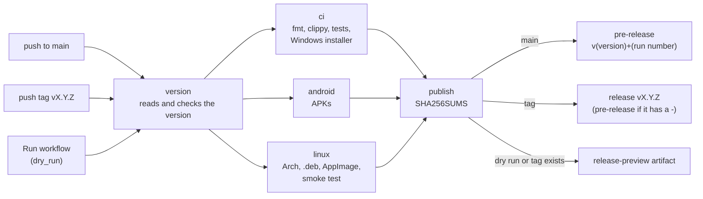

# Releasing

The *Release* workflow builds every package from one commit and publishes them in one GitHub Release:

- **Every push to `main`** publishes a pre-release tagged `v<version>+<run number>` (for example
  `v0.2.0-alpha+57`), so each merged change can be tried at once. The tag is created by the release.
- **A `vX.Y.Z` tag** publishes the release of that version. Tags containing `-` (for example
  `v0.2.0-alpha`) are published as pre-releases. The workflow fails at once if the tag does not
  match the workspace version.

## Versioning

The version is `version` in `[workspace.package]` of the root `Cargo.toml`; every crate, the
packages and the Android app (`versionName`, and `versionCode` derived from it) follow it. Bump it
in its own commit (`Bump the version to X.Y.Z`) before tagging a release, choosing the part by the
size of the changes since the last release: patch (`x.y.Z`) for fixes and small, self-contained
changes (including a single small feature), minor (`x.Y.0`) for medium changes (several features, a
reworked screen or flow), major (`X.0.0`) for a large overhaul. Keep the pre-release suffix
(`-alpha`) while the project is in alpha. Never tag a release under the previous version.

## Steps

1. Bump the version as above and run `cargo update -w` so `Cargo.lock` follows. Merge that to
   `main` (which also publishes a pre-release of it).
2. Optional dry run: *Actions, Release, Run workflow* on `main` with `dry_run` ticked (the default).
   It runs the whole pipeline and uploads the files as the `release-preview` artifact, without
   creating a release.
3. Tag and push:

   ```sh
   git tag vX.Y.Z
   git push origin vX.Y.Z
   ```

## What the workflow does



| Job | What it does |
| --- | --- |
| `version` | Reads the workspace version, checks it against the tag and picks the tag of a `main` pre-release (skipped if that tag already exists). |
| `ci` | Calls `ci.yml`: fmt, clippy and tests on Linux, the Windows build and installer (`ezdisplay-windows-installer`). |
| `android` | Calls `android.yml`: the APKs (`ezdisplay-android-apks`). |
| `linux` | Calls `linux-packages.yml`: the Arch package (`ezdisplay-arch`), one `.deb` per distro (`ezdisplay-deb-ubuntu24.04`, `-debian13`, `-ubuntu26.04`), the AppImage (`ezdisplay-appimage`) and its sources (`ezdisplay-appimage-sources`), plus a smoke test of the AppImage on a clean Debian 13. |
| `publish` | Runs only when all of the above pass. Collects the release files, writes `SHA256SUMS` and creates the release or the `main` pre-release with generated notes (or uploads `release-preview` on a dry run or when the pre-release tag already exists). |

The release assets are:

- `ezdisplay-setup-<version>-x64.exe` (Windows installer);
- `ezdisplay-<version>-1-x86_64.pkg.tar.zst` (Arch);
- `ezdisplay_<version>-1~ubuntu24.04_amd64.deb`, `..~debian13_amd64.deb`, `..~ubuntu26.04_amd64.deb`;
- `ezdisplay-<version>-x86_64.AppImage`;
- `ezdisplay-<version>-appimage-sources.tar` (see below);
- `ezdisplay-<version>-full-debug.apk` and `ezdisplay-<version>-play-debug.apk`;
- `SHA256SUMS`.

Pull requests run `ci.yml`, `android.yml` and `linux-packages.yml` on their own; their artifacts are
the way to try a change before it is merged. On `main` those workflows run only through *Release*.

## GPL obligations of the AppImage

The AppImage bundles FFmpeg and x264 built with `--enable-gpl`, so the combined work it ships is
under the GPL. ezdisplay itself stays MIT or Apache-2.0. To comply:

- The exact sources of everything bundled (FFmpeg, x264, plus the headers used to build them), the
  build script and the pins are published next to the AppImage as
  `ezdisplay-<version>-appimage-sources.tar`, and as the `ezdisplay-appimage-sources` artifact.
  Always publish that file in the same release as the AppImage, and keep it for as long as the
  AppImage is available.
- The AppImage carries the licence texts and a notice with the version and configure line in
  `usr/bin/licenses/` (the app's licence view reads it from there).
- When you change `packaging/linux/appimage/pins.env` or the FFmpeg configure line in `build.sh`,
  the sources tarball changes with them: nothing else to update by hand.
